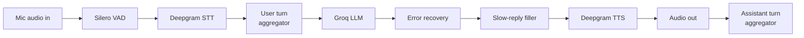

# CALL-E

**A real-time AI sales voice agent.** Give it your product sheet, and its AI rep, Alex, calls
you up and pitches it: live, by voice, sticking to the facts you gave it.

CALL-E is a ground-up rebuild of a 2024 project (Flask + Deepgram + GPT-3.5) as a proper
streaming voice pipeline, built with [Pipecat](https://github.com/pipecat-ai/pipecat). It runs
entirely on free tiers.


---

## What it does

1. **Learns your product.** Upload a `.txt`, `.md` or `.pdf` product sheet (or paste notes).
   CALL-E condenses it into a short, structured **product brief**: overview, features, pricing,
   ideal customer, objections, competitors, and a **"Not covered"** list. You can edit it before
   the call.
2. **Calls you.** Alex opens the conversation, asks about your needs, handles objections, and
   answers from the brief. Anything under "Not covered" gets an honest *"I'm not sure, I'll have
   the team follow up"* instead of a made-up answer.
3. **Talks like a person on the phone.**
   - Interrupt Alex mid-sentence and it stops; an "mm-hmm" doesn't.
   - Say "hold on" and it waits; go quiet and it checks in, then says goodbye.
   - On a "no", it asks about your needs once; on a second "no" (or "I have to go") it wraps up.
4. **Shows its latency live.** A per-turn chart of the time from you finishing a sentence to
   Alex's first sound: typically **~1.1 to 1.3 s** in test calls.

### Highlights

- **Streaming pipeline:** speech-to-text, LLM and text-to-speech run concurrently, frame by
  frame, so Alex starts speaking before the full reply is written.
- **Grounded answers:** facts only from the brief; web results (optional) are marked "(web)" and
  phrased cautiously; never invents prices, links or sign-up steps.
- **Prompt-injection defense:** uploaded material is wrapped in nonce-tagged delimiters and
  treated as data, both when building the brief and on the call.
- **Guardrails for a public demo:** 5-minute calls with a spoken wrap-up, per-visitor and daily
  rate limits, concurrent-call cap, one-time call tokens.
- **Resilience:** LLM errors are retried once, then Alex says a short fallback line instead of
  going silent; slow replies get a brief filler ("One moment.") that never enters the history.
- **Measured, not guessed:** a per-turn latency observer, plus an evaluation script that compares
  LLMs on rule adherence and time to first token ([results](docs/evals/2026-10-21-llm-persona-eval.md)).

---

## How it works

### System


1. **`POST /api/briefs`**: material in, structured brief out (one Groq request, validated, one
   automatic retry).
2. **`POST /api/calls`**: the (possibly edited) brief is validated and rate limits are checked;
   the server returns a one-time `call_id`.
3. **`POST /api/offer`**: the browser opens a WebRTC connection carrying that `call_id`; offers
   without a fresh one are rejected before any media is set up.
4. The server runs one voice pipeline for the call, capped at 5 minutes.

### The voice pipeline



| Stage | What it does |
|---|---|
| **VAD** (Silero) | Detects speech start/stop; placed before STT so Deepgram can finalize the last words immediately when you stop. |
| **STT** (Deepgram Nova-3) | Streams interim and final transcripts. |
| **User aggregator** | Decides when your turn is over (Smart Turn v3.2 model, runs locally), adds your words to the conversation, and triggers barge-in. A custom start strategy needs 3 words to interrupt Alex, so backchannels don't. |
| **LLM** (Groq) | `gpt-oss-20b` by default, or `qwen3.8-27b` via `CALLE_LLM_MODEL`. Streams the reply. |
| **Error recovery** | Retries a failed response once, then speaks a fallback line. |
| **Filler** | Says "One moment." if no text arrives within 1.5 s. |
| **TTS** (Deepgram Aura-2) | Speaks sentence by sentence. |
| **Assistant aggregator** | Sits *after* audio output, so the history only contains what you actually heard. |

A latency observer watches frames from outside the pipeline (so measuring adds no delay) and
streams per-turn timings to the browser.

---

## Tech stack

| | |
|---|---|
| Orchestration | [Pipecat](https://github.com/pipecat-ai/pipecat) 1.12 (SmallWebRTC transport, RTVI) |
| Speech | [Deepgram](https://deepgram.com) Nova-3 (STT), Aura-2 (TTS) |
| LLM | [Groq](https://groq.com): `openai/gpt-oss-20b` (default), `qwen/qwen3.8-27b` |
| Turn-taking | Silero VAD + Pipecat Smart Turn v3.2 (local ONNX) |
| Web search (optional) | [Tavily](https://tavily.com) |
| Backend | Python 3.12, FastAPI, managed with [uv](https://docs.astral.sh/uv/) |
| Frontend | Vite + vanilla TypeScript, `@pipecat-ai/client-js`, Web Audio API |
| Tests | pytest (fully offline: fake LLM, simulated frames) |

**$0 to run:** every service above has a free tier; no paid plan is needed.

---

## Getting started

### Prerequisites

- Python 3.12 and [uv](https://docs.astral.sh/uv/getting-started/installation/)
- Node.js 22 (only to build the web client)
- Free API keys: [Deepgram](https://console.deepgram.com), [Groq](https://console.groq.com/keys),
  and optionally [Tavily](https://app.tavily.com) for web enrichment

### Setup

```bash
git clone https://github.com/Eightalmond/coldcalling-agent-2.0.git
cd coldcalling-agent-2.0
uv sync
cp .env.example .env   # then add your keys
```

Check the keys work (one tiny request per service; keys are never printed):

```bash
uv run python scripts/smoke_test.py
```

### Run the web app

```bash
cd client && npm install && npm run build && cd ..
uv run python -m calle.server
```

Open **http://localhost:7860**, use headphones, and either upload a product sheet or click
**"Skip: use the demo product"** (Quillo, a fictional AI meeting assistant). Allow the
microphone when asked; Alex speaks first.

For frontend work with hot reload, keep the server running and use `cd client && npm run dev`
(http://localhost:5173, proxies `/api` to the server).

### Other ways to use it

```bash
# Build a brief from the command line (written to briefs/<product>.md)
uv run python scripts/make_brief.py --name Quillo --company "Brightfern Labs" \
  --description "AI meeting notes" --file examples/quillo_material.md

# Talk to the bot in Pipecat's dev playground with that brief
uv run python -m calle.bot --brief briefs/quillo.md

# Use the Qwen model instead of gpt-oss
CALLE_LLM_MODEL=qwen uv run python -m calle.server
```

### Configuration

| Variable | Required | Purpose |
|---|---|---|
| `DEEPGRAM_API_KEY` | yes | Speech-to-text and text-to-speech |
| `GROQ_API_KEY` | yes | The LLM (live calls and brief generation) |
| `TAVILY_API_KEY` | no | Enables optional web enrichment of briefs |
| `CALLE_LLM_MODEL` | no | `gpt-oss` (default) or `qwen` |
| `CALLE_BRIEF` | no | Brief file for `calle.bot` (same as `--brief`) |
| `CALLE_ALLOWED_ORIGINS` | no | CORS origins, comma-separated (for a separately hosted client) |
| `CALLE_TRUST_PROXY` | no | `1` to read the visitor IP from `X-Forwarded-For` behind a proxy |
| `CALLE_ICE_SERVERS` | no | JSON list of STUN/TURN servers for WebRTC beyond localhost |
| `VITE_API_BASE_URL` | no | Client build: API URL when the UI is hosted elsewhere |

Limits (call length, rate limits, word thresholds, timeouts) are named constants in
`src/calle/guardrails.py`, `turn_taking.py` and `bot.py`.

---

## Testing

```bash
uv run pytest
```

94 offline tests, no keys or network needed. Highlights: brief generation with a fake LLM
(file types, scanned PDFs, truncation, retry, prompt-injection delimiters), the HTTP API and
guardrails with a fake clock and fake WebRTC, and turn-taking run through Pipecat's real user
aggregator (backchannels don't interrupt; "wait" does; split transcripts aren't lost).

**LLM evaluation** (calls Groq, uses the free tier):

```bash
uv run python scripts/eval_persona.py --runs 2 --out docs/evals/<name>.md
```

Replays tricky conversation moments ("what's your website?", a first and second "no", an
opt-out...) against each model and checks the persona's rules automatically. See
[docs/evals](docs/evals/) for logged runs.

---

## Project layout

```
src/calle/
  server.py         FastAPI app: brief + call API, WebRTC signalling, serves the UI
  bot.py            the voice pipeline (also runnable with Pipecat's dev runner)
  prompts.py        Alex's persona + the demo brief
  knowledge.py      material -> validated product brief
  turn_taking.py    barge-in, hold, idle check-ins
  guardrails.py     rate limits, one-time call tokens; call_timer.py: call cap
  llm_recovery.py   retry / fallback on LLM errors; filler.py: slow-reply filler
  metrics.py        per-turn latency observer; log_redaction.py: no keys/prompt in logs
  llm_models.py     CALLE_LLM_MODEL presets; config.py: settings from .env
client/             web UI (Vite + TypeScript)
scripts/            smoke_test.py, make_brief.py, eval_persona.py
tests/              offline pytest suite
docs/evals/         logged LLM evaluations
examples/           fictional product sheet for testing
```

---

## Notes and limitations

- **Alex says it's an AI** if you ask, and the demo product (Quillo by Brightfern Labs) is
  fictional.
- **Rate limits live in memory**, so they reset when the server restarts; fine for one instance.
- **WebRTC beyond localhost** needs a TURN relay (planned: Cloudflare's free tier).
- **LLM rule-following isn't perfect.** Smaller models occasionally run long or embellish; the
  eval script exists to measure exactly that.

## Roadmap

- [ ] Public deployment: client on Vercel, server on Hugging Face Spaces (Docker), Cloudflare TURN
- [ ] Live-test Qwen and decide the default model ([eval notes](docs/evals/2026-10-21-llm-persona-eval.md))
- [ ] Demo video and screenshots

## Acknowledgements

Built on [Pipecat](https://github.com/pipecat-ai/pipecat) by Daily, with
[Deepgram](https://deepgram.com), [Groq](https://groq.com) and [Tavily](https://tavily.com).
